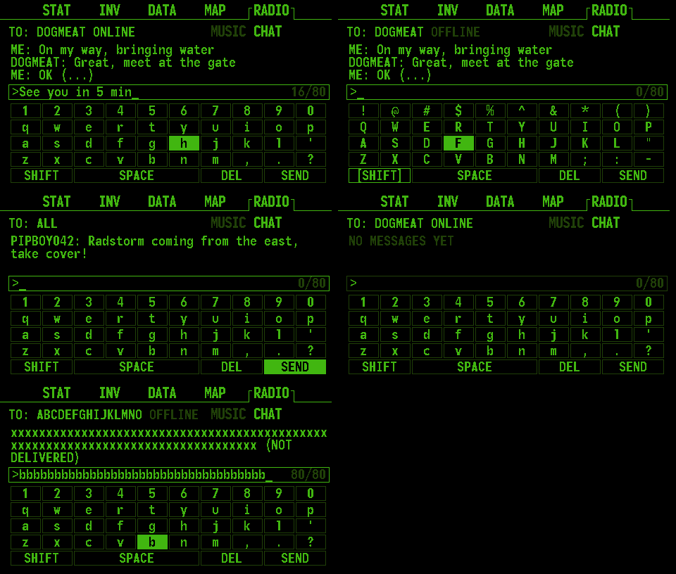

# Chat communication

[Project overview](../../README.md) · [Screens](../screens/README.md) · [Music](../music/README.md)

RADIO → CHAT exchanges short text messages with nearby Pip-Boys using
ESP-NOW. Messages are typed on an English (QWERTY) on-screen keyboard, by
tapping keys on the resistive touchscreen or with the secondary encoder. A
Wi-Fi router or internet connection is not required.



## Sending and receiving

1. Power on two compatible Pip-Boys within radio range. Give them distinct
   device names: discovery and recipient matching use those names.
2. Turn the main encoder to RADIO and the secondary encoder to CHAT. If you
   are browsing MUSIC, hold the secondary button to return to subpage selection.
3. Allow a few seconds for discovery. Tap **ALL** (everyone nearby) or a peer
   to open the conversation, or click to browse the list, turn to choose and
   click again.
4. Type with the keyboard (see below) and press **SEND** to send. The message
   is added to the conversation and the draft is cleared.
5. Hold the secondary button to return to the peer list; hold again to return
   to subpage selection. The draft is kept until it is sent or deleted.

The last three lines of the open conversation are shown above the draft, with
`ME:` for your messages and the sender's name for others. The header shows the
peer and whether it is ONLINE. A conversation stays open if the peer goes
offline; messages can still be sent but are only received if the peer is back
in range.

An incoming message for a conversation that is not on screen opens a message
window with the sender's name and the text. Tap, click or hold to dismiss it. A
running game pauses; click again to resume after dismissing the message.
Background music continues.

**NO SIGNAL** means that no online peer is listed. Check that both devices
run compatible firmware and use the same radio channel. There is no delivery
receipt; the history is kept in RAM until reboot.

## Keyboard

| Control | Action |
| --- | --- |
| Tap a key | Press that key. It also becomes the encoder selection. |
| Secondary encoder turn | Move the highlight through the keys in reading order. It wraps around, so **SEND** is one detent left of `1`. All detents between frames are used. |
| Secondary encoder click | Press the highlighted key. |
| Secondary button hold | Leave the conversation. |
| Main encoder turn | Switch the main tab, as everywhere else. |

```text
1 2 3 4 5 6 7 8 9 0        ! @ # $ % ^ & * ( )
q w e r t y u i o p        Q W E R T Y U I O P
a s d f g h j k l '   ->   A S D F G H J K L "
z x c v b n m , . ?        Z X C V B N M ; : -
SHIFT  SPACE  DEL  SEND    [SHIFT] (caps lock on)
```

SHIFT is a caps lock: it stays on until it is pressed again. Messages are
limited to 80 printable ASCII characters (the counter shows the draft length).
SPACE does nothing at the start of a draft or after another space.

## Discovery and message format

[src/appRadio.cpp](../../src/appRadio.cpp) initializes QuickESPNow on channel 1.
Devices broadcast a discovery ping roughly every three seconds. Up to four
peers are tracked, with entries expiring after 150 UI ticks (about five seconds
at 30 frames per second). Names fit in 15 characters and are stored in EEPROM.

Packets have five tab-separated fields:

```text
PIPBOY<TAB>sender<TAB>recipient<TAB>command<TAB>body
```

`<TAB>` represents a literal tab byte. Discovery uses recipient `_`, command
`P` and body `_`. A chat message uses command `M` and the text as its body; the
recipient is the selected peer's name, or `_` for ALL. Frames are broadcast at
the ESP-NOW transport level; the receiver filters messages by recipient name,
with `_` accepted as broadcast. This implementation has no authentication or
encryption.

Outgoing and incoming text is sanitized to printable ASCII without tabs,
with repeated spaces collapsed and both ends trimmed. 80 characters plus two
15-character names fit in a single packet. Packets whose sender name is not
printable ASCII are dropped.

Older firmware sent emotes with command `E` and a code such as `wave`. These
are still received and shown in the conversation as text such as `*Wave*`,
but they can no longer be sent.

The receive callback accepts at most 126 bytes with no embedded NUL and copies
packets into a four-entry queue. Parsing, peer updates and notifications run
on the UI thread. Excess packets can be dropped when the queue is full.

## Implementation

- `lib/Chat/src/Chat.cpp` holds the keyboard layout, draft editing, text
  sanitizing, word wrap and a 24-message history ring shared by all
  conversations. It has no Arduino, display or radio dependency.
- `ChatRender.cpp` draws the conversation, draft and keyboard at 480×272 with
  the bundled monofonto10 font and the existing green palette.
- `src/appRadio.cpp` owns the history and draft, sends and receives packets
  and adapts drawing to Arduino_GFX. `src/encoders.cpp` routes keyboard turns
  before the normal submenu/list handlers, the same way as for games.
- `src/touch.cpp` polls the XPT2046 once per frame and reports single taps;
  `chat::keyIndexAt()` maps a tap to the key drawn there. Calibration and
  wiring are described in the [hardware guide](../hardware/README.md#resistive-touch).
- `./test/host/run.sh` covers the library. `python3 scripts/preview_chat.py
  --output docs/communication/previews` regenerates the screens above; they
  are software renders, not device captures.

## Checks on two devices

- Confirm discovery in both directions, then send messages to a peer and to
  ALL, including shifted symbols, an 80-character message and DEL.
- Type by tapping, including keys at the screen corners and the wide bottom
  row; check that one tap types exactly one character. Adjust calibration if
  taps land on a neighboring key.
- Tap while music is playing from SD; playback must not stutter or stop.
- Receive a message with the conversation open (no window) and closed
  (message window); dismiss it.
- Move one device out of range or turn it off; confirm it leaves the peer list
  and an open conversation shows OFFLINE.
- Receive a message while playing music and while a game is running; check
  uninterrupted audio and game pause/dismiss/resume behavior.
- If a device still runs older firmware, send an emote from it and confirm it
  appears as text.

These checks require two physical devices. Host tests of the keyboard and
rendering do not establish ESP-NOW delivery, radio range, touch accuracy or
encoder feel.
