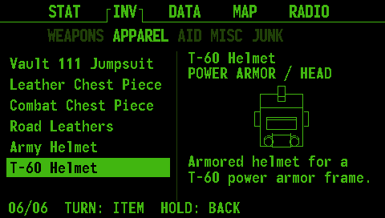

# Fallout inventory with 3D models

[Project overview](../../README.md) · [Screens](../screens/README.md) · [Build and development](../development/README.md)

INV contains 30 representative Fallout 4 items across the existing five categories.
The selection follows Fallout 4 item categories; it is an illustrated reference
inventory, with no equip, consume, quest or character-stat effects. Item text is
original concise wording describing qualitative roles; it does not claim exact
weapon/armor stats, which depend on modifications and game rules.

## Controls and layout

Turn the main encoder to INV. Rotate the secondary encoder to choose WEAPONS,
APPAREL, AID, MISC or JUNK. Click to browse that list, rotate to select an item,
and hold to return to category selection. The six item names remain visible on
all current pages. The selected item has its own slowly rotating 3D wireframe model, type or
ammunition/material label, and a short description. The header font is restored
after the inventory body so tab switches and ESP-NOW notifications retain the
normal UI font. Music continues on its independent audio task.

## Art and content sources



The models are original low-poly shapes built from simple solids (boxes,
extrusions, cylinders, spheres) in `assets/inventory/models.py`, inspired by the
item shapes. They are stylized interpretations, not extracted game meshes,
screenshots, textures, or exact reproductions. Source
links below document names, item roles and Fallout 4 classification. Research
was checked on 16 October 2026.

Category references: [weapons](https://fallout.fandom.com/wiki/Fallout_4_weapons),
[apparel](https://fallout.fandom.com/wiki/Fallout_4_armor_and_clothing),
[aid](https://fallout.fandom.com/wiki/Fallout_4_consumables),
[miscellaneous](https://fallout.fandom.com/wiki/Fallout_4_miscellaneous_items),
[junk](https://fallout.fandom.com/wiki/Fallout_4_junk_items).

| Category | Item and reference | Model function |
| --- | --- | --- |
| WEAPONS | [10mm Pistol](https://fallout.fandom.com/wiki/10mm_pistol_(Fallout_4)) | `10mm-pistol` |
| WEAPONS | [Laser Rifle](https://fallout.fandom.com/wiki/Laser_gun_(Fallout_4)) | `laser-rifle` |
| WEAPONS | [Combat Shotgun](https://fallout.fandom.com/wiki/Combat_shotgun_(Fallout_4)) | `combat-shotgun` |
| WEAPONS | [Hunting Rifle](https://fallout.fandom.com/wiki/Hunting_rifle_(Fallout_4)) | `hunting-rifle` |
| WEAPONS | [Fat Man](https://fallout.fandom.com/wiki/Fat_Man_(Fallout_4)) | `fat-man` |
| WEAPONS | [Super Sledge](https://fallout.fandom.com/wiki/Super_sledge_(Fallout_4)) | `super-sledge` |
| APPAREL | [Vault 111 Jumpsuit](https://fallout.fandom.com/wiki/Vault_jumpsuit_(Fallout_4)) | `vault-111-jumpsuit` |
| APPAREL | [Leather Chest Piece](https://fallout.fandom.com/wiki/Leather_armor_(Fallout_4)) | `leather-chest` |
| APPAREL | [Combat Chest Piece](https://fallout.fandom.com/wiki/Combat_armor_(Fallout_4)) | `combat-chest` |
| APPAREL | [Road Leathers](https://fallout.fandom.com/wiki/Road_leathers_(Fallout_4)) | `road-leathers` |
| APPAREL | [Army Helmet](https://fallout.fandom.com/wiki/Army_helmet_(Fallout_4)) | `army-helmet` |
| APPAREL | [T-60 Helmet](https://fallout.fandom.com/wiki/T-60_power_armor_(Fallout_4)) | `t60-helmet` |
| AID | [Stimpak](https://fallout.fandom.com/wiki/Stimpak_(Fallout_4)) | `stimpak` |
| AID | [RadAway](https://fallout.fandom.com/wiki/RadAway_(Fallout_4)) | `radaway` |
| AID | [Rad-X](https://fallout.fandom.com/wiki/Rad-X_(Fallout_4)) | `rad-x` |
| AID | [Nuka-Cola](https://fallout.fandom.com/wiki/Nuka-Cola_(Fallout_4)) | `nuka-cola` |
| AID | [Mentats](https://fallout.fandom.com/wiki/Mentats_(Fallout_4)) | `mentats` |
| AID | [Purified Water](https://fallout.fandom.com/wiki/Purified_water_(Fallout_4)) | `purified-water` |
| MISC | [Bobby Pin](https://fallout.fandom.com/wiki/Bobby_pin_(Fallout_4)) | `bobby-pin` |
| MISC | [Holotape](https://fallout.fandom.com/wiki/Fallout_4_holotapes) | `holotape` |
| MISC | [Overdue Book](https://fallout.fandom.com/wiki/Overdue_book) | `overdue-book` |
| MISC | [Book Return Token](https://fallout.fandom.com/wiki/Book_return_token) | `book-token` |
| MISC | [Subway Token](https://fallout.fandom.com/wiki/Subway_token) | `subway-token` |
| MISC | [Vault-Tec Bobblehead](https://fallout.fandom.com/wiki/Vault-Tec_bobblehead_(Fallout_4)) | `bobblehead` |
| JUNK | [Duct Tape](https://fallout.fandom.com/wiki/Duct_tape_(Fallout_4)) | `duct-tape` |
| JUNK | [Desk Fan](https://fallout.fandom.com/wiki/Desk_fan_(Fallout_4)) | `desk-fan` |
| JUNK | [Wonderglue](https://fallout.fandom.com/wiki/Wonderglue_(Fallout_4)) | `wonderglue` |
| JUNK | [Alarm Clock](https://fallout.fandom.com/wiki/Alarm_clock_(Fallout_4)) | `alarm-clock` |
| JUNK | [Typewriter](https://fallout.fandom.com/wiki/Typewriter_(Fallout_4)) | `typewriter` |
| JUNK | [Telephone](https://fallout.fandom.com/wiki/Telephone_(Fallout_4)) | `telephone` |

## Editing and firmware generation

Edit `assets/inventory/catalog.json` (names and descriptions) and
`assets/inventory/models.py` (one function per item id returning a list of
parts), then run:

```sh
python3 scripts/build_inventory.py
python3 scripts/build_inventory.py --check
./test/host/run.sh
pio run
```

`scripts/inventory_mesh.py` provides the parts: `box`, `extrude` (any simple
polygon), `lathe`, `cylinder`, `frustum`, `sphere`, `ring` and
`rounded_rectangle`, plus `move`, `scale`, `rotate`, `along_x` and `along_z`.
Every part must be a closed surface; the build fixes face orientation itself
and rejects open, flat or self-intersecting parts and models over 1024
vertices or faces. It scales each model to ±1000, triangulates the faces and
lists every edge with its two faces and whether it is a sharp edge (over 40°).
`lib/Inventory/src/InventoryData.h` is generated and checked in; PlatformIO needs
no Python to build the firmware.

### Hidden-line rendering

`inventory::drawModel()` turns the model around its vertical axis (one turn in
about 8 seconds, from `millis()`) and tilts it 0.35 rad towards the viewer. It
then:

1. Culls faces that point away from the viewer.
2. Fills the remaining triangles into a 240×100 depth buffer, without drawing them.
3. Draws silhouette edges (one face visible) and sharp edges between visible
   faces, pixel by pixel, only where no nearer surface covers them.
4. Sends the lit pixels to the canvas as horizontal runs.

So wires behind the model, or behind another part of it, are never drawn. The
scale comes from the model's widest extent over a full turn, so it does not
change size while it rotates. The buffers use about 63 KB of static RAM.

`lib/Inventory` is the hardware-independent catalog, drawing and layout code.
`src/appInv.cpp` adapts it to Arduino_GFX and existing encoder state. The body
uses the bundled monofonto10 font for readable names and bounded descriptions.

## Preview and verification

```sh
# Optional: requires Pillow and host g++.
python3 scripts/preview_inventory.py
# Refresh the committed review images:
python3 scripts/preview_inventory.py --output docs/inventory/previews --review
# Pick the item for the animated turntable.gif (default t60-helmet):
python3 scripts/preview_inventory.py --output docs/inventory/previews --review --spin desk-fan
```

Previews use the actual firmware catalog/layout and bundled font glyphs at
480x272. Still images show the models at a three-quarter turn.
They are software reference renders, not captures from a physical board.

[All 30 screens](previews/contact-sheet.png) · [Weapons](previews/10mm-pistol.png) ·
[Apparel](previews/t60-helmet.png) · [Aid](previews/stimpak.png) ·
[Misc](previews/holotape.png) · [Junk](previews/desk-fan.png)

The host checks exercise all 30 selections in both navigation modes, every
model, hidden-line checks on test cubes, exact native font/pixel bounds, nonblank/distinct drawings, invalid
categories and stale selection indices. Existing metadata, audio boost and
background-player tests remain part of the same sanitizer-backed command.

On the board, browse every category and item, hold to change categories, then
switch tabs while music is playing. Confirm text contrast, model legibility, smooth rotation,
encoder behavior and uninterrupted sound on the real display/speaker.
